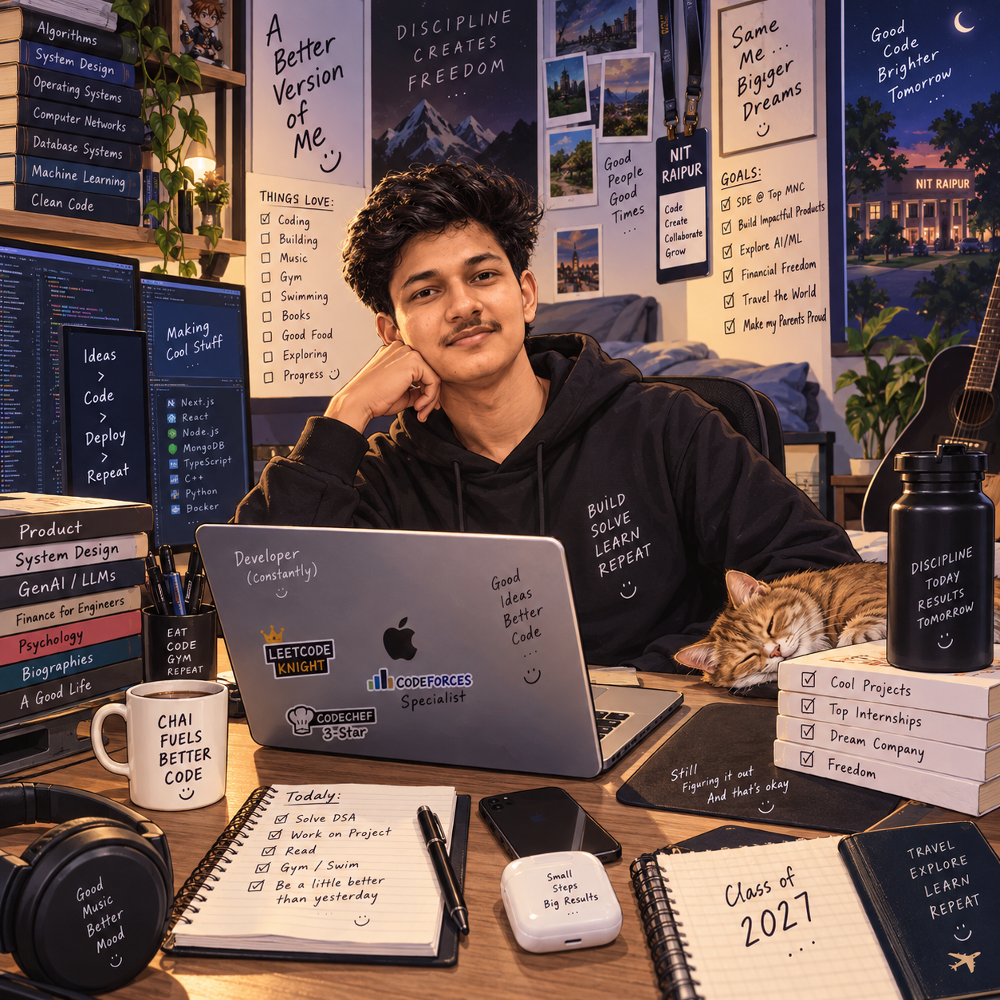
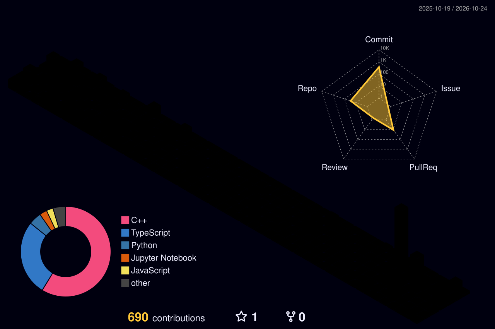

  

<strong>Backend &amp; Full-Stack Engineer · NIT Raipur ’27</strong>

  

**From an API request to a completed job — I enjoy building what happens in between.**

I build **reliable backend services, event-driven systems, real-time applications, and AI-powered products.**

## ✦ About me

- 🎓 **B.Tech CSE**, National Institute of Technology Raipur · **2023–2027**
- 🏗️ Focused on **backend engineering, distributed systems, async processing, APIs, and observability**
- 🤖 Exploring **agentic AI, LangGraph, RAG, and multi-agent workflows**
- 🧩 **1,800+ DSA / competitive programming problems** solved
- 🤝 Contributed a **merged TypeScript backend fix** to open source, backed by integration tests
- 💼 Open to **SDE / backend / full-stack opportunities** for 2027

## ⚡ Engineering by the numbers

| 🧠 Problem solving | 🏅 Competitive coding | 🚀 EventForge local benchmark | 🏆 Hackathons |
| :---: | :---: | :---: | :---: |
| **1,800+ problems** | **LC 1973 · CF 1638** | **404–712 req/s** | **ET Gen AI winner** |
| DSA & CP | CC **4★ · 1750** | **31–57 ms p95** ingestion | Amazon ML **AIR 545 / 818** |

EventForge numbers are from three local Docker test bursts with 1,500 events; they are not production throughput claims.

## 🧰 Tech stack

## 🛠️ Featured projects

<table>
<tr>
<td width="50%" valign="top">

### ⚙️ [EventForge](https://github.com/abhikhurannah/EventForge)
**Multi-tenant event processing & job queues**

`TypeScript` `Fastify` `Redis` `BullMQ` `MongoDB` `React`

- Idempotent ingestion and tenant-scoped APIs
- Priority queues, exponential retries, dead-letter recovery
- Signed webhooks, rate limits, job dashboards & latency metrics
- **Local:** 404–712 accepted req/s; 31–57 ms p95 ingestion

[**Source →**](https://github.com/abhikhurannah/EventForge) · [**Demo →**](https://event-forge-kappa.vercel.app/)

</td>
<td width="50%" valign="top">

### 💬 [Chatty AI](https://github.com/abhikhurannah/Chatty-AI)
**Real-time messaging with AI assistance**

`React` `TypeScript` `Node.js` `Socket.IO` `MongoDB` `Gemini`

- Real-time messaging, online presence & image sharing
- JWT auth with cookie and Bearer-token support
- Gemini-powered replies, autocomplete & conversation analysis
- Debounced suggestions and AI failure fallbacks

[**Source →**](https://github.com/abhikhurannah/Chatty-AI) · [**Demo →**](https://chatty-ai-dusky.vercel.app/)

</td>
</tr>
<tr>
<td width="50%" valign="top">

### 🧬 [Pharma](https://github.com/abhikhurannah/pharma-agentic-langgraph)
**Multi-agent pharmaceutical research assistant**

`Python` `FastAPI` `LangGraph` `Gemini` `React`

- Drug repurposing literature analysis
- **4 agents:** planning, search, summarization & reporting
- Summaries of **3–5 papers** with ranked research findings
- Prototype uses a curated demo literature dataset

[**Source →**](https://github.com/abhikhurannah/pharma-agentic-langgraph)

</td>
<td width="50%" valign="top">

### 📰 [NewsNavigator](https://github.com/abhikhurannah/news-intel-story-spark)
**Gen AI news project**

- News intelligence and story exploration
- Built for the **Economic Times Gen AI Hackathon 2025**
- **Winner** — NewsNavigator

[**Source →**](https://github.com/abhikhurannah/news-intel-story-spark)

</td>
</tr>
</table>

## 💼 Experience & open source

**🌐 Open-Source Contributor — Endora Commerce** · *Oct 2026*

- Merged **PR #266**: fixed TypeScript newsletter API serialization while preserving nullable response contracts with **MikroORM + Zod**.
- Added **2 Vitest integration tests** covering PostgreSQL entity reloads, serialization, and schema validation; passed **8 CI checks**.

**💳 Software Developer Intern — AshwaQuant Pvt. Ltd.** · *May–Jul 2025*

- Built a full-stack trading-education course platform, supporting enrollment and onboarding.
- Integrated **Razorpay** payment processing and verification; developed and tested **Node.js / Express REST APIs**.

## 📊 Contribution highlights

### 🌌 My contributions in 3D

<!-- Generated by .github/workflows/contribution-art.yml -->

### 🐍 Watch the contribution trail

<!-- Generated by .github/workflows/contribution-art.yml -->

Contribution visuals are generated from public GitHub activity. The 3D graphic appears after the workflow runs and commits it to the default branch; the snake is served from the <code>output</code> branch.

## 🏆 Milestones

| Highlight | Result |
| --- | --- |
| 🏅 **Economic Times Gen AI Hackathon 2025** | **Winner** — NewsNavigator |
| 🧠 **Amazon ML Challenge 2026** | **AIR 545** — Business Entity Resolution |
| 🤖 **Amazon ML Challenge 2025** | **AIR 818** among 85,000+ teams |
| ♟️ **LeetCode** | **Knight, 1973** · WC 495 rank **804** · BWC 192 rank **311** |
| ⚔️ **Codeforces / CodeChef** | **Expert, 1638** / **4-Star, 1750** |
| 📚 **GATE CSE 2025 / KVPY 2022** | **AIR 9221** / **AIR 2000** |

---

### Build. Observe. Improve. Repeat.

**Interested in backend systems, event-driven platforms, or useful AI products?**

[**Let's connect**](https://www.linkedin.com/in/abhay-kumar101/) · [**Drop me a note**](mailto:abhaykumar.official101@gmail.com)

